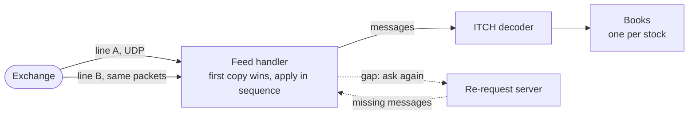
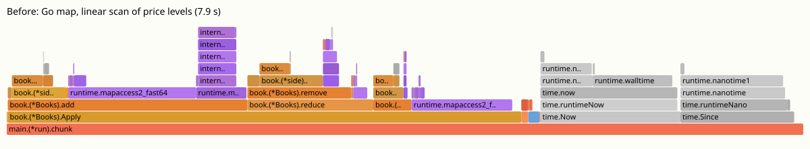
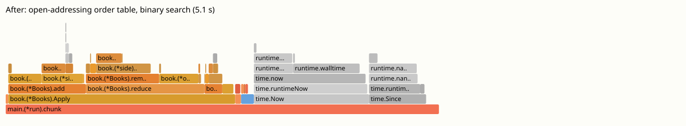

# itchbook

[](https://github.com/ksamirdev/itchbook/actions/workflows/ci.yml)

A low-latency market-data feed handler in Go that rebuilds the order book of every Nasdaq stock from the exchange's raw binary feed.

I built it to learn what trading firms mean by "low latency", and whether Go can get there despite its garbage collector.
It reads Nasdaq TotalView-ITCH 5.0, the real feed, and every number below comes from replaying one full trading day of it: 268,744,780 messages from 30 December 2019.

## The problem, with an example

Nasdaq does not send you the order book.
It sends a stream of small binary events:

```text
A  ref=7212  AAPL  buy 100 @ 290.10     a new order rests on the book
E  ref=7212  executed 30                someone traded with 30 of its shares
U  ref=7212  now ref=7301, 70 @ 290.12  the owner moved its price
D  ref=7301                             the order was cancelled
```

A trading firm has to rebuild, from that stream, the full list of buy and sell orders at every price for every stock.
It has to do it fast, because a strategy cannot act on a price until its book shows that price.

This project does three things:

1. **Decodes the feed** without allocating, by reading fixed big-endian offsets straight out of the packet.
2. **Rebuilds every book** in under 100 ns per message on average, with data structures chosen by measuring them on real data.
3. **Receives it over UDP the way exchanges send it**: two copies of every packet on two lines, losses filled in by asking the exchange again, and the result audited against a perfect replay.

## Quick start

You need Go 1.26 and [just](https://github.com/casey/just).

```sh
just data    # download one full trading day from Nasdaq (3.5 GB)
just bench   # replay the whole day through the books, print the latency histogram
just feed    # send it over UDP on two lossy lines, rebuild the books on the other side
just test
```

`just bench` prints (trimmed):

```text
messages        268744780 in 35.241s (7.6M msg/s through the book, 1m13.975s wall)
latency ns      p50 83  p90 209  p99 375  p99.9 711  p99.99 3071  max 421541
clock           smallest tick 41ns, empty measurement p50 0ns p99 42ns
gc              1 cycles, 33.792µs total pause, 22431 allocations while applying (0.000083 per message)
resting orders  0 at the end, order table grew 0 times
crossed books   664 messages left a trading book crossed
```

## How it works

### The big picture



### The main pieces

**Decoder - "what does this message say?"**
Every ITCH message has a fixed layout, so decoding is reading integers at known offsets.
It takes about 5 ns and never allocates.

**Order table - "which order is ref 7212?"**
Executes, cancels, deletes and replaces only name the order by its reference number, so every one starts with a lookup.
A custom [open-addressing](https://en.wikipedia.org/wiki/Open_addressing) hash table finds the order once and changes or removes it in place.
It is sized and touched up front, so it never grows or page-faults during the day.
[ADR 3](docs/adr/0003-open-addressing-order-table.md) has the measurements.

**Price levels - "how many shares are bid at 290.10?"**
Each side of each book is a slice of 16-byte levels sorted with the best price last, found by binary search.
Asks store the complement of the price, so both sides share one code path.
[ADR 2](docs/adr/0002-price-levels-in-a-sorted-slice.md).

**No garbage collector work - "what about Go's GC?"**
Nothing the book keeps contains a pointer, and memory is reserved at start of day.
The collector ran once in the whole day, for 34 µs.
[ADR 5](docs/adr/0005-pointer-free-hot-path.md).

**Feed handler - "what if a packet is lost?"**
Nasdaq sends the feed as [MoldUDP64](https://www.nasdaqtrader.com/content/technicalsupport/specifications/dataproducts/moldudp64.pdf) packets, each numbered, on two lines.
The handler applies messages strictly in sequence, so the copy that arrives first wins and the other is a duplicate.
If both lines lose a packet, it asks the exchange's re-request server for the missing range.
[ADR 4](docs/adr/0004-apply-strictly-in-sequence.md).

**Audit - "is the book right?"**
In the tests, a deliberately simple book built from maps is compared with the fast one after every message, on random streams and under Go's fuzzer.
On the real day, every order that was added was removed by the close (0 resting orders at the end), and no message was rejected.
After every UDP run, the rebuilt books are compared level by level with books built by applying every message once, in order.

## Results

### The book, one full day

One process on an Apple M3 Pro, 268,744,780 messages.
Latency is decode plus apply for one message.

| | first version | now |
| --- | --- | --- |
| Throughput, untimed (`-time=false`) | 6.2M msg/s | **11.6M msg/s** (86 ns/msg) |
| Latency p50 | 167 ns | 83 ns |
| Latency p99 | 543 ns | 375 - 419 ns |
| Latency p99.9 | 1,055 ns | 711 - 799 ns |
| Latency p99.99 | 5.2 µs | 3.1 - 4.4 µs |
| GC cycles while applying | 3 | 1 |
| Allocations while applying | 124,131 | 22,431 |

The first version used a Go map for orders and a linear scan for levels.
Ranges are two runs.
On Linux (Docker on the same laptop, first 20M messages) the book does 7.5 - 8.1M msg/s timed, p99 419 - 459 ns.

The CPU profile before and after, drawn on the same time scale, only the time inside the book:




The Go map (purple) was most of the time.
After the change, the clock reads (`time.Now`, grey) are almost as wide as the book itself, which is why throughput is measured untimed.

### The feed over UDP

2M real messages at 500,000 messages/s over loopback UDP, each line dropping 1% of packets at random.
"Send to book" is from the exchange writing the packet to the books showing it.
"Read to book" is from the socket read returning to the books showing it.

| | Linux, one thread polls all sockets | Linux, a goroutine per socket | macOS, one thread | macOS, a goroutine per socket |
| --- | --- | --- | --- | --- |
| Send to book p50 | **4.0 µs** | 12 - 266 µs | 16 µs | 22 µs |
| Send to book p99 | 9.6 - 11 µs | 2.9 ms | 28 - 29 µs | 35 - 47 µs |
| Read to book p50 | 2.6 µs | 7 - 15 µs | 3.0 µs | 4.3 µs |
| Gaps | 4 - 5 | 185 - 245 | 4 | 4 |
| Books match the perfect replay | yes | yes | yes | yes |

With 1% loss per line and about 42,000 packets, about 4 packets are lost on both lines, so 4 gaps is the floor.
Linux here is OrbStack's VM, so its tail varies from run to run; some runs of the single-thread mode had a p99.9 of several milliseconds when the VM was descheduled.

## Things I found by measuring

### 1. My guess about the price levels was wrong

I wrote the level search as a linear scan from the best price, because most updates land near the top of the book.
Binary search was faster at every percentile: p99 went from 503 to 419 ns.
Real books have stale orders hundreds of levels from the price, and those deletes walked the whole side.

**Lesson:** "most of the time" is the p50, but the tail is made of the other cases.

### 2. A good hash function was a slow one

The textbook choice, [Fibonacci hashing](https://probablydance.com/2018/06/16/fibonacci-hashing-the-optimization-that-the-world-forgot-or-a-better-alternative-to-integer-modulo/), spread the order refs evenly and sent every new order to a random cache line in a 192 MB table.
Using the ref itself was 3 times faster at p50, because Nasdaq numbers new orders nearly in order, but p99.9 went from 0.8 to 5 µs: runs of live orders built long full stretches, and deleting from one walks to its end.
Keeping runs of 512 consecutive refs together and scattering the runs got the fast p50 and the short tail.

**Lesson:** the data's shape matters more than the hash function's reputation.

### 3. The clock costs as much as the work

Apple Silicon's clock ticks every 41.67 ns, so most single messages measure as 0, 1 or 2 ticks.
Reading it twice per message took about 40% of the timed loop.
The percentiles are still useful for the tail, but throughput is measured without them, and the benchmark prints the clock's resolution next to its results.

**Lesson:** at nanosecond scale, check what the measurement costs before trusting it.

### 4. Crossed books that were not bugs

A book where the best bid is at or above the best ask is "crossed", and usually means the book is wrong.
The first run found 415 of them.
Every one was in a halted stock: a halted stock still accepts orders but does not match them.
The book now tracks each stock's trading state, and the check only counts trading stocks.
On the full day, 664 messages still left a trading book crossed.
Of those, 22 were halted stocks resuming and 631 were executions of the reopening auction that uncrosses the book.

**Lesson:** before fixing a "wrong" result, find out which rule of the real system it follows.

### 5. Asking for missing messages caused a flood

When a stretch of packets was lost, the handler asked for it again.
Each packet of the answer moved the handler forward, so it saw the rest of the range as still missing and asked again, for a range already on its way.
A new test reproduced it: 85 requests for one gap.

**Fix:** remember what was asked for, ask again only after a silence, and double the wait each time nothing comes.

### 6. A goroutine per socket lost packets that one thread did not

The idiomatic Go design reads each socket in its own goroutine and hands packets to the book over a channel.
On Linux it stalled for milliseconds: [`go tool trace`](https://pkg.go.dev/cmd/trace) showed the time was goroutines waiting to be scheduled after a channel send.
Worse, it turned single-line losses into gaps.
When line A lost a packet and line B's copy was scheduled late, A's next packet arrived first and was dropped as out of order: 185 - 245 gaps instead of 4.
One thread busy-polling every socket never waits for the scheduler.

**Lesson:** dropping out-of-order packets is only cheap if the two lines stay in step.

### 7. The garbage collector was not the problem

Go's GC is the usual reason given for not using Go here.
With a pointer-free heap there is nothing for it to scan: it ran once in the whole day, and on the first 20M messages `GOGC=off` changed nothing measurable.
The tail came from allocations instead: the first order for a stock allocated its price levels.
The allocation profile showed nothing at first, because Go's allocation profile only includes allocations up to the last GC, and there had been almost none.

**Fix:** reserve 64 levels per side when the Stock Directory message announces a stock, before the open.

## What I learned

- **Measure on real data.** Every structure I picked by intuition changed after the first replay of a real day.
- **The tail and the median are different problems.** The median is about cache lines; the tail is about deep books, page faults, allocation and the scheduler.
- **Go can be fast when the hot path looks like C.** Plain structs in slices, indexes instead of pointers, memory reserved up front.
- **Concurrency is not free at microsecond scale.** Handing work between goroutines cost more than the work.
- **Correctness first.** A simple model, a fuzzer and an end-of-day audit made every optimisation safe to try.

I wrote my design decisions down as [ADRs](docs/adr) (short notes on what I decided and why).

## How I built this

I built this with [Claude Code](https://claude.com/claude-code) as a pair programmer.
It wrote most of the code and the tests, and ran the benchmarks and profiles.
I decided what to build, asked questions until I understood each piece, and didn't accept a result until the numbers held up.

Rules I followed:

- Measure on the real day before and after every change, and keep the change only if the numbers improve.
- Explain every surprising number before moving on. For example, the crossed books were traced to halts before any code changed.
- Add a test that fails without each fix, and run the full suite with `-race`.

## What's missing and what I'd try next

- **Queue position.** Levels hold totals, not the order of orders inside them, so the book cannot say where an order stands in line.
- **A reorder buffer.** A small buffer for packets that arrive ahead of a gap would make A/B arbitration safe for any reader.
- **Real hardware.** These numbers are on a laptop and a VM. Next: a Linux machine with pinned, isolated cores, kernel receive timestamps, and the exchange on another machine.
- **Kernel bypass.** Reading packets with AF_XDP or a vendor library instead of the socket API.
- **A C++ version.** Same design, same data, to see what Go costs.

## Project layout

| Package | What it does |
| --- | --- |
| [`internal/itch`](internal/itch) | Decodes ITCH 5.0 messages and splits ITCH files |
| [`internal/book`](internal/book) | Order table, price levels and the books of every stock |
| [`internal/mold`](internal/mold) | MoldUDP64 packets |
| [`internal/feed`](internal/feed) | Feed handler: A/B arbitration, sequencing, re-requests |
| [`internal/exchange`](internal/exchange) | The exchange's side: packing packets and answering re-requests |
| [`internal/hist`](internal/hist) | Fixed-size latency histogram |
| [`cmd/bench`](cmd/bench) | Replays a day through the books and reports latency |
| [`cmd/feedbench`](cmd/feedbench) | Runs exchange and handler over UDP with loss, then audits the books |

No dependencies outside the Go standard library.

<details>
<summary>What I read</summary>

- [Nasdaq TotalView-ITCH 5.0 specification](https://www.nasdaqtrader.com/content/technicalsupport/specifications/dataproducts/NQTVITCHspecification.pdf). The message formats.
- [MoldUDP64 specification](https://www.nasdaqtrader.com/content/technicalsupport/specifications/dataproducts/moldudp64.pdf). Packets, sequence numbers and re-requests.
- [Nasdaq ITCH sample files](https://emi.nasdaq.com/ITCH/Nasdaq%20ITCH/). The data.
- [HdrHistogram](http://hdrhistogram.org/). The idea behind the histogram.
- [Fibonacci Hashing: The Optimization that the World Forgot](https://probablydance.com/2018/06/16/fibonacci-hashing-the-optimization-that-the-world-forgot-or-a-better-alternative-to-integer-modulo/), Malte Skarupke.
- [Linear probing](https://en.wikipedia.org/wiki/Linear_probing), including deletion without tombstones.
- [A Guide to the Go Garbage Collector](https://go.dev/doc/gc-guide). Why a pointer-free heap costs the collector nothing.
- [Flame Graphs](https://www.brendangregg.com/flamegraphs.html), Brendan Gregg.

</details>

## License

[MIT](LICENSE)
